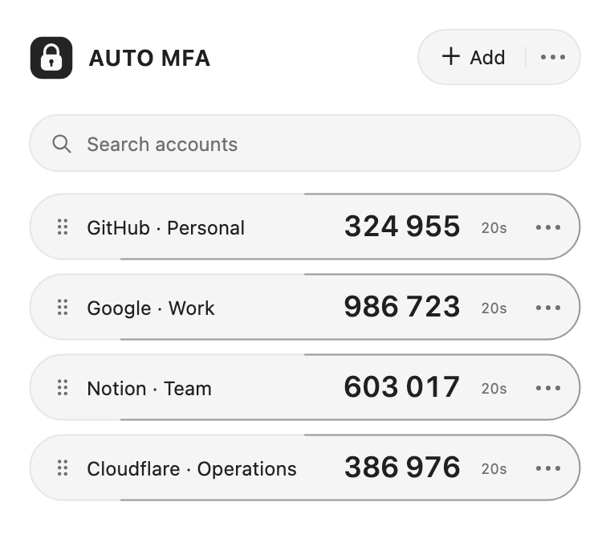
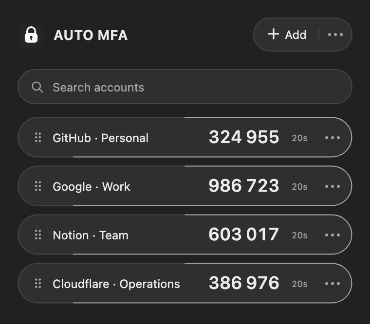
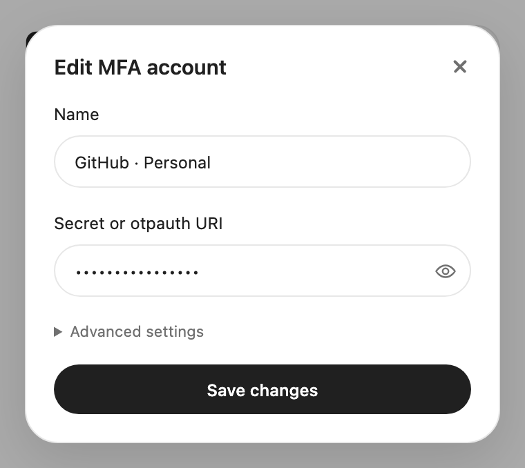
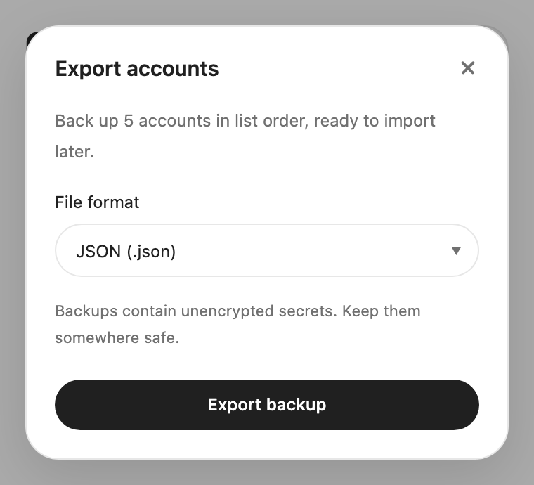

# AUTO-MFA

[English](README.md) · [简体中文](README.zh-CN.md)

A lightweight MFA authenticator with QR setup, manual entry, backups and context-menu autofill. Supports internationalization. Since 0.0.0.6, development is carried out entirely with AI; people define requirements and review the results.

[Install from the Chrome Web Store](https://chromewebstore.google.com/detail/auto-mfa/iffhgapiplhilmdggnmlndnpbhcjokpe)

[Privacy policy](docs/privacy/PRIVACY.en.md)

## Screenshots

<table><tr><td></td><td></td></tr><tr><td></td><td></td></tr></table>

Screenshots use demo accounts only.

## Usage

- **Add and edit**: Paste, drop or select QR images, or enter a secret/otpauth URI. Supports SHA1/256/512, 6/8 digits and custom periods. Sensitive edits require confirmation; QR codes can be saved as PNG.
- **Use codes**: Click to copy, drag a code out, or select an account from a web input’s context menu to autofill.
- **Organize**: Reorder by dragging or with arrow keys; search appears above four accounts. Confirm title edits with Enter, cancel with Esc.
- **Back up**: Export JSON, XML or YAML; import JSON, XML, .yaml or .yml up to 2 MB. Backups use `secret` and accept legacy JSON `id`. YAML support covers this project’s schema. Imports validate and deduplicate before merging; failed writes preserve existing data.

Backups contain unencrypted secrets. Keep them somewhere safe.

## License

© 2026 ydq and contributors. Original code and artwork use 0BSD, allowing use, modification and commercial distribution. Third-party licenses remain applicable.

[0BSD](LICENSE) · [MIT / Apache-2.0](THIRD_PARTY_NOTICES.md)
