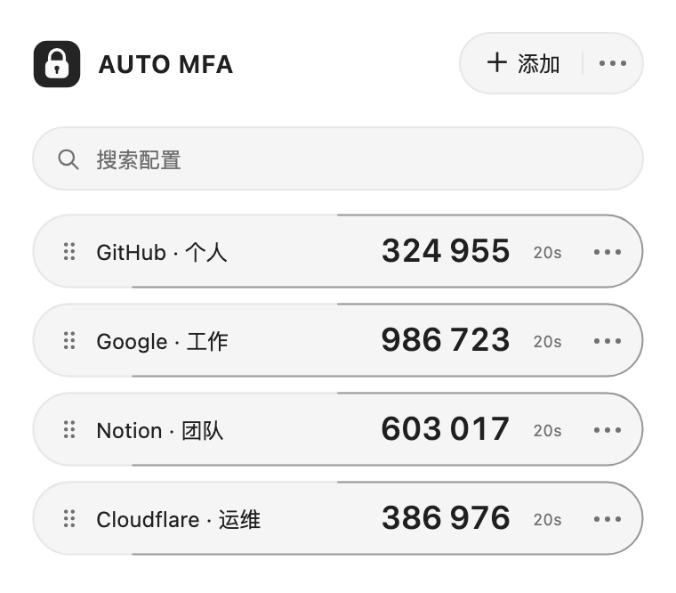
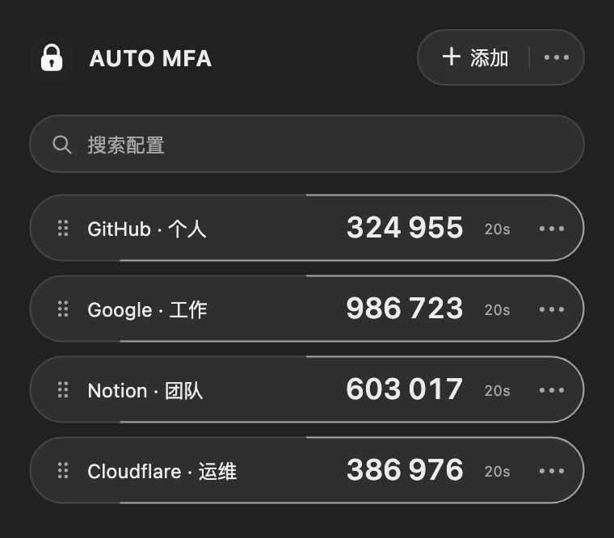
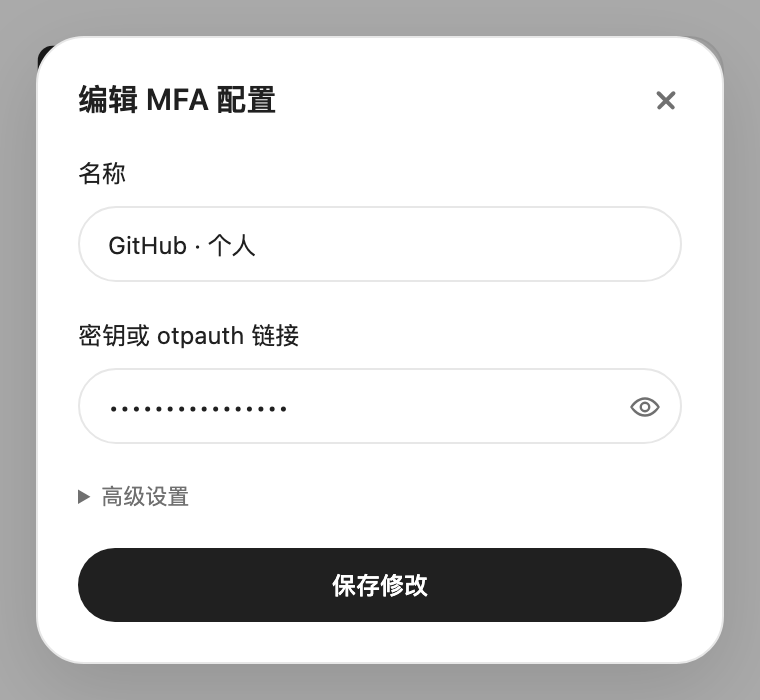
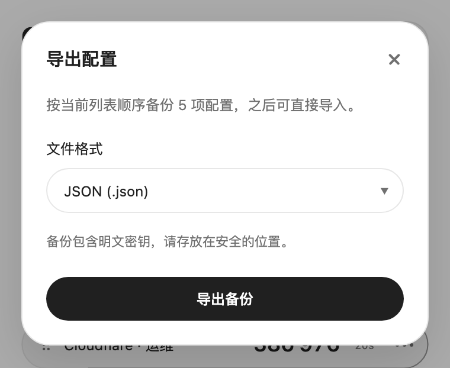

# AUTO-MFA

[English](README.md) · [简体中文](README.zh-CN.md)

轻量的 MFA 验证器，支持二维码、手动配置、备份与右键填充。支持国际化。自 0.0.0.6 起，全程使用 AI 开发，人类负责提出需求与验收。

[从 Chrome 应用商店安装](https://chromewebstore.google.com/detail/auto-mfa/iffhgapiplhilmdggnmlndnpbhcjokpe)

[隐私政策](docs/privacy/PRIVACY.zh-CN.md)

## 界面截图

<table><tr><td></td><td></td></tr><tr><td></td><td></td></tr></table>

截图仅使用演示账号。

## 使用

- **添加与编辑**：粘贴、拖放或选择二维码图片，也可手动输入密钥或 otpauth 链接。支持 SHA1/256/512、6/8 位验证码及自定义周期。敏感修改需二次确认，二维码可保存为 PNG。
- **使用验证码**：点击复制、拖出验证码，或在网页输入框的右键菜单中选择账号填充。
- **整理配置**：拖拽或按方向键排序，超过四项时显示搜索框。标题编辑按 Enter 确认、Esc 撤销。
- **备份配置**：导出 JSON、XML 或 YAML；导入支持 JSON、XML、.yaml 和 .yml，最大 2 MB。统一使用 `secret`，兼容旧 JSON `id`；YAML 仅支持本项目结构。导入校验去重后合并，写入失败时保留原数据。

备份包含明文密钥，请妥善保管。

## 许可

© 2026 ydq and contributors. 项目自身代码与素材采用 0BSD，可自由使用、修改和商业分发；第三方依赖保留各自许可。

[0BSD](LICENSE) · [MIT / Apache-2.0](THIRD_PARTY_NOTICES.md)
